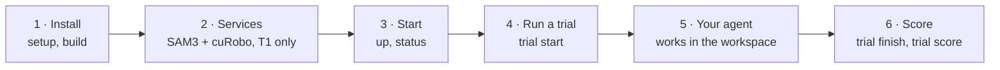

<div align="center">

# EmbodiedLab

### Benchmarking Embodied Agents That Act to Know

Manipulation benchmarks test whether a robot can act to change the world; EmbodiedLab tests whether it can act to know. Given only an objective and the apparatus, the agent runs its own experiment in a physics-based laboratory to find out a result it cannot know in advance.

[](https://hexafuture.ai/benchmarks/embodiedlab/)
[](https://arxiv.org/abs/2610.35385)
[](LICENSE)
[](https://developer.nvidia.com/isaac/sim)

**English** | [简体中文](README.zh-CN.md)

[Overview](#overview) •
[Experiments](#the-30-experiments) •
[Interface levels](#interface-levels) •
[Leaderboard](#leaderboard) •
[Getting started](#getting-started) •
[Connecting an agent](#connecting-your-agent) •
[Scoring](#scoring) •
[Citation](#citation)

<a href="https://hexafuture.ai/benchmarks/embodiedlab/#video"></a>

</div>

## Overview

Embodied agents are expected to accomplish real-world goals by deciding for themselves how and when to interact with their surroundings. For many such goals, changing the physical state of the world is the means rather than the end. The agent changes the state of a system, observes the feedback and keeps exploring until it knows what the goal requires. We call this **acting to know**.

Manipulation benchmarks stop at acting to change: the target state is given. Scientific-discovery benchmarks evaluate knowing, but they replace the physical experiment with text commands or numerical queries. **EmbodiedLab** puts the two together in quantitative science experiments.


- 🔬 **30 experiments in five disciplines.** Mechanics, circuits, optics, thermal physics and chemistry, built on 14 apparatus platforms; 18 are basic and 12 are advanced.
- 🎲 **A new instance every time.** The hidden parameters of the system are drawn anew for every instance, so the answer cannot be known in advance, yet it can be scored exactly.
- 🤖 **The agent decides how.** The agent gets an objective and the apparatus, with no method. It operates a Franka arm in a physics-based laboratory (NVIDIA Isaac Sim) and reads the instruments through three cameras.
- ✅ **Scored on what was really done.** A run succeeds only if it meets all three conditions:
  - the result is within a tolerance set by the instruments;
  - the result is grounded in readings recorded during the episode;
  - the bench is left in the state the task requires.
- 🧩 **Any agent that runs Python can take part.** A coding agent, a ReAct loop or a hand-written controller all use the same API.

<div align="center">

<br><sub><b>One episode.</b> (a) An instance draws hidden parameters θ, and the task card states what to find out. (b) The agent acts and observes through cameras and instruments. (c) The submission is checked against the hidden target, the recorded evidence and the final state of the bench.</sub>
</div>

## The 30 experiments

<div align="center">

</div>

Every experiment belongs to one of four capability dimensions, each describing what makes it hard:

- **Fine manipulation and contact:** delicate grasps, placements and contacts.
- **Long-horizon multi-stage:** many dependent stages that must all succeed.
- **Fine reading:** reading scales, displays and positions at the instrument's resolution.
- **Multi-point data and analysis:** many readings combined in an analysis.

<details>
<summary><b>Full list with tolerances and budgets</b> (click to expand)</summary>

<br>

| # | id | Experiment | Discipline | Dimension | Tier | Tolerance | Sim budget (s) | Wall limit (s) |
|---|---|---|---|---|---|---|---|---|
| 1 | `hooke_k` | Spring stiffness (Hooke's law) | Mechanics | Fine reading | basic | 2% | 500 | 7200 |
| 2 | `pendulum_g` | Gravitational acceleration with a simple pendulum | Mechanics | Fine manipulation | basic | 0.3% | 200 | 7800 |
| 3 | `coupled_modes` | Coupled oscillators: the two normal-mode frequencies | Mechanics | Fine manipulation | basic | 0.2% | 300 | 15000 |
| 4 | `hooke_dynamic_k` | Spring stiffness from oscillations | Mechanics | Multi-point data | basic | 0.2% | 500 | 10800 |
| 5 | `torsion_inertia` | Torsion pendulum: moment of inertia | Mechanics | Multi-point data | basic | 1% | 500 | 15600 |
| 6 | `airtrack_collision` | Air track: an unknown mass from a collision | Mechanics | Multi-point data | basic | 0.5% | 300 | 16800 |
| 7 | `incline_friction` | Static and kinetic friction on an incline | Mechanics | Fine manipulation | basic | 5%, 0.5% | 600 | 9600 |
| 8 | `rc_capacitance` | An unknown capacitance in an RC circuit | Circuits | Multi-point data | basic | 0.5% | 300 | 17400 |
| 9 | `resistor_blackbox` | An unknown resistance in a black box | Circuits | Multi-point data | basic | 0.3% | 300 | 14400 |
| 10 | `led_planck` | The wavelength of an unknown LED | Circuits | Long-horizon | basic | 2% | 500 | 21000 |
| 11 | `lens_focal` | Focal length of a converging lens | Optics | Fine reading | basic | 1% | 500 | 14400 |
| 12 | `grating_wavelength` | Laser wavelength with a diffraction grating | Optics | Fine reading | basic | 1% | 200 | 14400 |
| 25 | `slit_width` | Slit width from single-slit diffraction | Optics | Fine reading | basic | 1% | 350 | 14400 |
| 26 | `plate_index` | Refractive index of a glass block | Optics | Fine reading | basic | 3% | 500 | 28800 |
| 27 | `battery_emf` | EMF and internal resistance of a battery | Circuits | Multi-point data | basic | 0.5% | 300 | 13800 |
| 28 | `thermistor_beta` | B constant of a thermistor | Thermal | Multi-point data | basic | 0.3% | 1000 | 15600 |
| 29 | `rod_expansion` | Linear expansion coefficient of a metal rod | Thermal | Fine reading | basic | 0.5% | 1200 | 17400 |
| 30 | `dye_absorptivity` | Absorption peak and molar absorptivity of an unknown dye | Chemistry | Fine manipulation | basic | 1 nm, 2% | 750 | 28800 |
| 13 | `torsion_centroid` | Torsion pendulum: centre of mass and centroidal moment of inertia | Mechanics | Long-horizon | advanced | 0.3 mm, 0.5% | 550 | 25200 |
| 14 | `projectile_landing` | Spring launcher: predict the landing point and catch the ball | Mechanics | Fine manipulation | advanced | 2% | 650 | 7200 |
| 15 | `beam_compliance` | Cantilever: beam stiffness versus clamp compliance | Mechanics | Fine reading | advanced | 0.5% | 300 | 14400 |
| 16 | `circuit_blackbox3` | Circuit black box: identify its network and component values | Circuits | Long-horizon | advanced | 0.5% | 450 | 19800 |
| 17 | `rectifier_supply` | Rectifier power supply: load capability and filter choice | Circuits | Long-horizon | advanced | 1% | 350 | 16200 |
| 18 | `spectro_basic` | Spectrophotometry: concentration of an unknown dye | Chemistry | Long-horizon | advanced | 2% | 770 | 14400 |
| 19 | `titration_basic` | Acid-base titration: concentration of hydrochloric acid | Chemistry | Fine manipulation | advanced | 0.5% | 600 | 19200 |
| 20 | `spectro_mixture` | Spectrophotometry: both concentrations in a two-dye mixture | Chemistry | Long-horizon | advanced | 3% | 990 | 18000 |
| 21 | `titration_weak_acid` | Weak-acid titration: concentration and pKa | Chemistry | Fine manipulation | advanced | 1%, 0.03 | 850 | 22200 |
| 22 | `kinetics_crystal_violet` | Kinetics: reaction orders and rate constant of crystal violet fading | Chemistry | Multi-point data | advanced | 2% | 800 | 21600 |
| 23 | `optical_relay` | Two-lens relay: an upright real image at a set magnification | Optics | Long-horizon | advanced | 3% | 1500 | 28800 |
| 24 | `calorimetry_specific_heat` | Specific heat of a metal by the method of mixtures | Thermal | Multi-point data | advanced | 1% | 1400 | 15600 |

Each experiment is fully specified by its task card, `experiments/<id>/task_card.md`. The card states the question, the apparatus, the acceptance conditions, the budget and the submission format, and gives no method.

</details>

## Interface levels

The same experiments can be run at two interface levels. They differ only in how much robot software the agent receives. The levels are enforced inside the environment: a tool outside a level is neither listed nor callable.

<div align="center">

</div>

| Level | The agent receives | Left to the agent |
|---|---|---|
| **T0** · raw control | three calibrated RGB views, the robot state with the hand pose, joint and gripper control, kinematics-only `solve_ik` (no collision check), the instruments and `submit` | perception, collision avoidance, path planning and every manipulation skill |
| **T1** · + perception & planning | everything in T0, plus SAM3 segmentation, depth back-projection of chosen pixels and masks, and collision-free hand motion planned with cuRobo | grasping, placing, pressing and every other manipulation skill |

[The paper](https://arxiv.org/abs/2610.35385) also studies a diagnostic level, T2, which adds a library of manipulation skills. T2 is not part of this release.

<details>
<summary><b>The eight T1 tools</b></summary>

<br>

| Group | Tools |
|---|---|
| SAM3 | `segment_sam3_point_prompt` (mask candidates at a pixel the agent chose), `inspect_mask_image` (close-up of a candidate) |
| Depth | `localize_rgbd_point` (world point of a pixel), `mask_geometry` (world bounds and median of a mask's visible points) |
| cuRobo | `move_hand` (plan and execute a collision-free path to a hand pose), `plan_return_to_start` (the same, back to the initial pose) |
| Helpers | `translate_contact` (move the hand slowly in a straight line, at most 5 cm, to touch or to back out of a contact: cuRobo does not plan from a pose in contact), `get_robot_pose` (the hand pose by forward kinematics, as in the robot state) |

</details>

## Leaderboard

Six frontier models, each run in the coding agent released by its developer at its middle reasoning setting: medium effort, the default of Codex and Claude Code, for the GPT and Claude models, and high effort with thinking enabled, the middle setting of the other three coding agents. Everything else is left at the defaults. Agents are ranked by their success rate at T0.

| Rank | Model | Coding agent | T0 success (%) | T0 process score | T1 success (%) | T1 process score |
|:---:|---|---|:---:|:---:|:---:|:---:|
| 🥇 | Claude Opus 5.5 | Claude Code | **43.3** | **64.0** | **53.3** | **73.7** |
| 🥈 | GPT-6 Astra | Codex | 40.0 | 62.8 | 46.7 | 61.0 |
| 🥉 | GPT-6.1 Sol | Codex | 28.3 | 55.7 | 30.0 | 51.7 |
| 4 | DeepSeek-V4.1-Flash | DSH | 10.0 | 36.0 | 13.3 | 36.7 |
| 5 | Kimi K3 | Kimi Code | 10.0 | 35.7 | 20.0 | 39.7 |
| 6 | GLM-5.3-Flash | ZCode | 0.0 | 16.3 | 3.3 | 20.7 |

Success rate and process score (0–100) are averaged first over the runs of each experiment and then over the 30 experiments. More results and typical failures are on the [website](https://hexafuture.ai/benchmarks/embodiedlab/).

**Key findings**

- **Acting to know is far from solved.** With native control (T0), even the strongest agent succeeds less than half the time.
- **What an agent can know is bounded by how reliably it interacts.** For strong and weak agents alike, most failures arise in interacting with the apparatus: acting on it, observing it and restoring it account for 75–100% of the failed runs, and reasoning from readings already in hand for at most 25%.
- **Help with perception is not help with contact.** Perception and motion planning (T1) raise the success rate by at most 10 points; in the paper's diagnostic level T2, manipulation skills help the weaker agents more.

## Getting started



### Requirements

| Item | Requirement |
|---|---|
| OS | Linux x86_64 |
| GPU | NVIDIA RTX GPU with 24 GB (tested on RTX 4090). An environment uses 3 to 10 GB; SAM3 and cuRobo together use about 10 GB on one GPU. |
| Software | NVIDIA driver, Docker with the [NVIDIA Container Toolkit](https://docs.nvidia.com/datacenter/cloud-native/container-toolkit/), Python 3.10 or newer with `venv` (Debian/Ubuntu: `python3-venv`), git, curl |
| Disk | about 35 GB for the lab image and 15 GB for SAM3 and cuRobo |
| Accounts | the Isaac Sim base image `nvcr.io/nvidia/isaac-sim:6.0.1` from NGC; access to [facebook/sam3](https://huggingface.co/facebook/sam3) on Hugging Face (T1 only) |
| T1 only | CUDA 12.x toolkit (`nvcc`) to build cuRobo |

### Step 1 · Install

```bash
git clone https://github.com/HexaFuture/EmbodiedLab.git
cd EmbodiedLab && git checkout v0.1.0
./embodiedlab setup     # checks the prerequisites and creates .venv
./embodiedlab build     # builds the lab image embodiedlab/lab:0.1.0 (also tagged :latest)
```

> [!TIP]
> GPUs, the data directory and ports are set in `embodiedlab.conf.local` (see [Advanced › Configuration](#advanced)). The defaults use GPU 0 and `./data`.

### Step 2 · Install the perception and planning services (T1 only)

```bash
./embodiedlab install-services   # SAM3 + cuRobo
```

To evaluate at T0 only, skip this step and set `EMBODIEDLAB_SERVICES=off`.

### Step 3 · Start the stack

```bash
./embodiedlab up         # starts SAM3, cuRobo, the Controller and one Worker per GPU
./embodiedlab status
```

### Step 4 · Start a trial

```bash
./embodiedlab trial catalog                                                    # the 30 experiments (--json for JSON)
./embodiedlab trial start --exp hooke_k --seed 0 --exposure T1 --agent my-agent
```

`trial start` starts an environment, prepares a workspace for the agent and prints the **agent prompt**. `--seed N` derives the hidden values and the layout of instance N deterministically, so runs on the same seed are comparable across agents. `--agent` labels the run so that all runs of one agent are scored together.

### Step 5 · Let your agent run the experiment

Give the printed prompt to your agent, with the trial's `workspace/` as its working directory (see [Connecting your agent](#connecting-your-agent)). The trial closes when the agent submits, or when the wall-clock limit is reached (`--wall-s`; the default is the experiment's own limit).

```bash
./embodiedlab trial status <trial_id>    # tool calls so far, submitted or not
```

### Step 6 · Score

```bash
./embodiedlab trial finish <trial_id>    # close the trial now: stop the environment and score it
./embodiedlab trial score                # success, process score and error of every finished trial
./embodiedlab down                       # stop every environment and the stack
```

> [!NOTE]
> **Checking an installation.** Run one trial end to end. `trial finish` writes `result.json` with the status:
> - `submitted`;
> - `not_submitted`;
> - `timeout` (wall clock);
> - `budget_exhausted` (simulated time);
> - `agent_terminated` (a physical protection the agent triggered);
> - `not_scored` (an infrastructure failure, to be rerun).
>
> After a submission it also writes `evaluation.json`.

## Connecting your agent

Everything the agent may see and use is in the trial's workspace, `data/trials/<trial_id>/workspace/`:

```text
workspace/
  task_card.md      the question, the apparatus, the acceptance conditions, the budget, the submission format
  README.md         the Python API and the table of tools at this level
  task_spec.json    the machine-readable task, including the submission schema
  tools.json        name, signature and description of every tool
  py                Python bound to this workspace
  embodiedlab_api/  the client (standard library only)
  calls.jsonl       every call the agent made, appended automatically
  images/           every image a tool returned
```

The agent acts only through the API and runs its code with `./py script.py` inside the workspace:

```python
from embodiedlab_api import connect

env = connect()                      # reads env.json in the workspace
env.task()                           # the public task specification
env.tools()                          # the tools available at this level
obs = env.observe()                  # three calibrated RGB views, saved as PNGs under images/
env.call("wait", seconds=5)          # advance simulated time (charged to the budget)
env.call("<tool>", **arguments)
env.submit(**fields)                 # once; the first submission closes the episode
```

The agent may write notes and its own helper code in the workspace, and must not read anything outside it.

> [!IMPORTANT]
> **Keep the hidden values away from the agent.** The stack writes each episode's hidden parameters to `data/instances/`. Use one of the following:
> - run the agent as a different user that can read and write its workspace but not `data/`;
> - or run it on another machine: `./embodiedlab trial pack <trial_id>` packs the workspace for a machine that reaches the Controller through an SSH tunnel.

Next to the workspace, the trial directory holds the outputs:

- `captures/`: video, the sealed evidence and the process record;
- `evaluation.json`: the evaluator's report;
- `process_score.json`: the six process levels;
- `result.json`: one summary row.

## Scoring

Every finished trial gets three scores. They are computed offline from what the environment recorded; the agent's own words are never used.

**Success.** Each experiment states its acceptance conditions (gates) in the task card. G = 1 when all of them hold, including the bench restoration the card asks for.

Every scored quantity has a tolerance set by what the instrument allows when used correctly:
- most are relative, from 0.2% to 5%;
- a few are absolute, such as a pKa within 0.03, a centre of mass within 0.3 mm or an absorption peak within 1 nm.

The episode error `e` is the largest error divided by its tolerance. A run succeeds when G = 1 and `e ≤ 1`.

**Process score.** It measures how far a run got, submitted or not, along six consecutive milestones that follow acting to know:

| Level | Milestone | Weight |
|:---:|---|:---:|
| L1 | **Hands-on:** the robot first acts on the experiment's apparatus | 10 |
| L2 | **Set up:** the apparatus is in a state from which a reasonable method can measure | 10 |
| L3 | **First valid reading** in such a state | 10 |
| L4 | **Enough data:** valid readings that suffice in principle for every scored quantity | 10 |
| L5 | **Accurate:** every gate except restoring passes, and `e ≤ 1` | 30 |
| L6 | **Restored:** every restoring gate passes as well, so the run succeeds | 30 |

The process score is the cumulative weight of the highest consecutive level reached (out of 100).

**Error.** The error is `e` over the valid submissions.

<details>
<summary><b>Output files and how a set of runs is scored</b></summary>

<br>

`trial finish` (or the watcher, when the episode closes) writes the scores to `result.json`.

`evaluation.json` lists every gate with its verdict. Under `quantities` it lists every scored quantity with:
- the submitted value and the true value;
- the absolute and the relative error;
- its tolerance and the error divided by the tolerance.

`process_score.json` lists each level with the simulated time it was reached and why. L1 to L4 are judged from the process record that the environment exports when it stops. L5 and L6 are judged from the evaluation of the sealed submission (`benchmark/evaluation/process.py`, rules in `benchmark/evaluation/process_rules/`).

```bash
./embodiedlab trial score                       # every finished trial under data/trials
./embodiedlab trial score --root DIR --json     # another trials directory, as JSON
```

`trial score` groups the trials by agent label and level. For each experiment, each discipline and overall it reports the success rate, the mean process score and the median `e` of the valid submissions. Each experiment first averages its runs; the overall line then averages the experiments, so that every experiment counts equally, and the discipline lines are a breakdown. Trials closed as `not_scored` are left out and listed for a rerun.

`result.json` also carries `bench_restore`, which is descriptive and not scored. For each loose item on the bench it gives:
- its displacement from where it stood before the first tool call;
- its tilt;
- whether it is back home.

</details>

## Advanced

<details>
<summary><b>Watching a trial live (Viser)</b></summary>

<br>

An environment can serve a live, read-only 3D view of its whole scene in the browser ([Viser](https://viser.studio)), for the person running the benchmark. It is off by default and switched on per trial:

```bash
./embodiedlab trial start --exp hooke_k --seed 0 --exposure T0 --viewer
./embodiedlab trial viewer <trial_id>     # its address, and the SSH tunnel to open it from another machine
```

The view listens on the benchmark host's `127.0.0.1` and lives as long as the environment. It takes no part in control or scoring. It mirrors the scene after each simulation step, so until the agent's first action that advances the simulation it shows only the axes.

- **It shows more than the agent may see, and it has no password.**
  - It shows every object of the scene from any angle.
  - Any process that reaches the host's `127.0.0.1` can open it; a different user account does not stop that.
  - Switch it on only when the agent cannot reach that address: an agent on another machine (`trial pack`), or one in a container without access to the host network.
  - Otherwise use it only for runs you do not score.
- **Keep it private.** Open it through an SSH tunnel and do not forward its port to a public address.
- **It costs host time.** With many environments on one host it adds CPU load and can slow trials down against their wall-clock limits.

</details>

<details>
<summary><b>Configuration</b></summary>

<br>

`embodiedlab.conf` documents every setting. Put your own values in `embodiedlab.conf.local`: it has the same format, is read after `embodiedlab.conf` and is not tracked by git. Environment variables override both.

| Setting | Default | |
|---|---|---|
| `EMBODIEDLAB_GPUS` | `0` | GPUs that run environments, comma separated |
| `EMBODIEDLAB_SLOTS_PER_GPU` | `1` | environments per GPU at the same time |
| `EMBODIEDLAB_DATA` | `./data` | instances, trials, logs, caches, the SAM3/cuRobo installation |
| `EMBODIEDLAB_SERVICES` | `on` | `off` runs without SAM3 and cuRobo (T0 only) |
| `EMBODIEDLAB_SERVICE_GPU` | `0` | GPU for SAM3 and cuRobo |
| `SAM3_CHECKPOINT` | | a local `sam3.pt` instead of the Hugging Face download |
| `EMBODIEDLAB_CONTROLLER_PORT` | `18731` | the Controller listens on 127.0.0.1 only |

Where PyPI, the PyTorch wheel index or GitHub are slow, point `PIP_INDEX_URL`, `EMBODIEDLAB_TORCH_INDEX`, `EMBODIEDLAB_SAM3_REPO` and `EMBODIEDLAB_CUROBO_REPO` at mirrors. `PIP_INDEX_URL` is also passed to the image build.

Logs are in `data/logs/` (`./embodiedlab logs controller`). The Controller has no authentication: keep it on 127.0.0.1 and reach it from other machines through SSH tunnels only.

</details>

<details>
<summary><b>Troubleshooting</b></summary>

<br>

- **A trial does not start and waits for a Worker.** An earlier environment may still hold it: on a loaded host, Docker sometimes misses a container's exit and the stop fails ("did not receive an exit event").
  - `trial finish` keeps stopping for three minutes and then prints what to do.
  - `./embodiedlab status` lists the running environments.
  - Once the container has exited (`docker ps`), `./embodiedlab trial finish <trial_id> --force` stops the environment, releases its Worker and scores the trial again.

</details>

<details>
<summary><b>Repository layout</b></summary>

<br>

```text
embodiedlab          the command line (setup, build, install-services, up, down, status, trial, logs)
embodiedlab.conf     settings
experiments/         the 30 experiments: experiment.yaml (spec), task_card.md, schemas/ (submission schema)
benchmark/           benches and physics (core/), evaluator (evaluation/), instance derivation (instances/),
                     experiment registry (registry/), apparatus kits (kits/)
sdk/                 runtime: Controller, Workers, the environment daemon, and the agent API embodiedlab_api
assets/              scene and robot assets used by the lab image
docker/lab/          the lab image (Isaac Sim 6.0.1 + benches)
services/            the SAM3 and cuRobo servers used by T1
scripts/trial.py     the trial runner behind ./embodiedlab trial
docs/assets/         figures used in this README
```

</details>

## Citation

If you use EmbodiedLab, please cite our paper:

```bibtex
@article{gao2026embodiedlab,
  title   = {{EmbodiedLab}: Benchmarking Embodied Agents That Act to Know},
  author  = {Gao, Hongcheng and Zheng, Zelin and Zhou, Alex and Zhu, Jay and Ge, Shijia and Wang, Yazhe and Li, Xiping and Zeng, Jianshu and Wu, Di and Shangguan, Xuan and Wan, Yexing and He, Lingyu and Wang, Yongli and Yu, Xiaohan and Jia, Zhiqi and Liu, Yue and Hooi, Bryan and Dong, Yinpeng and Zhang, Wentao and Wu, Sihang and He, Xiao},
  journal = {arXiv preprint arXiv:2610.35385},
  year    = {2026}
}
```

## License

EmbodiedLab is released under the Apache License 2.0 (see [`LICENSE`](LICENSE)).

It builds on third-party software under their own licences, which you accept when you install them:
- NVIDIA Isaac Sim (the base image);
- SAM3 by Meta (SAM License; the model weights are gated on Hugging Face);
- NVIDIA cuRobo (NVIDIA Source Code License).

See [`THIRD_PARTY_NOTICES.md`](THIRD_PARTY_NOTICES.md).

<div align="center">
<br>
<a href="https://hexafuture.ai"></a>
</div>
