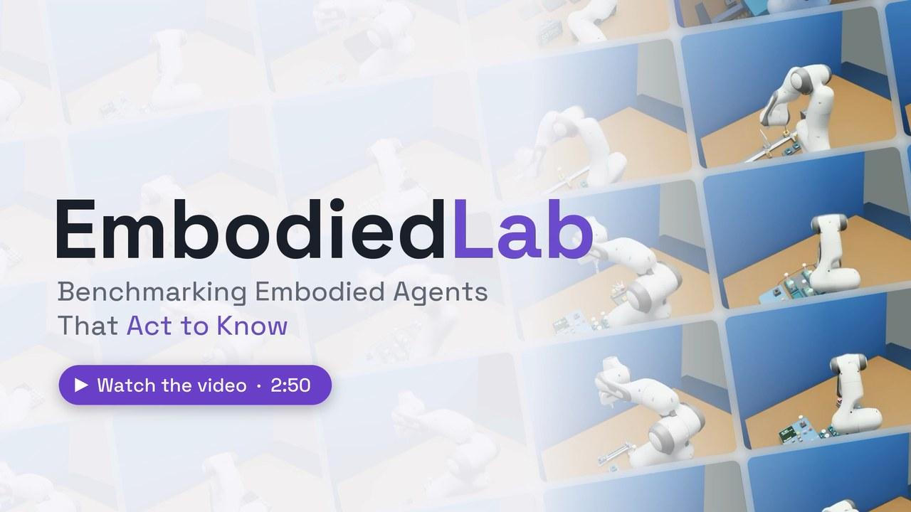
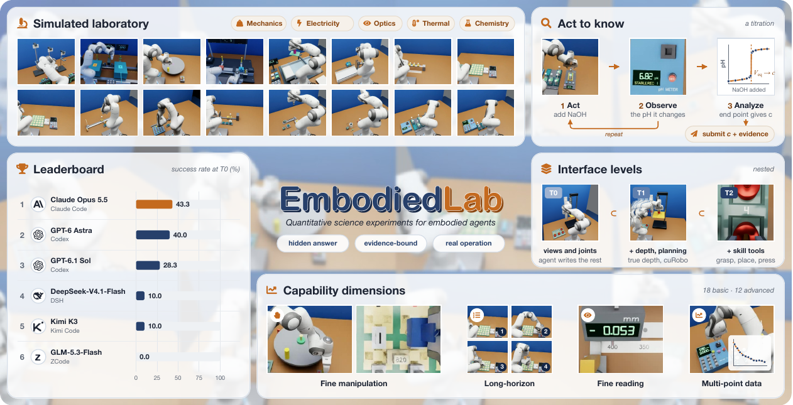
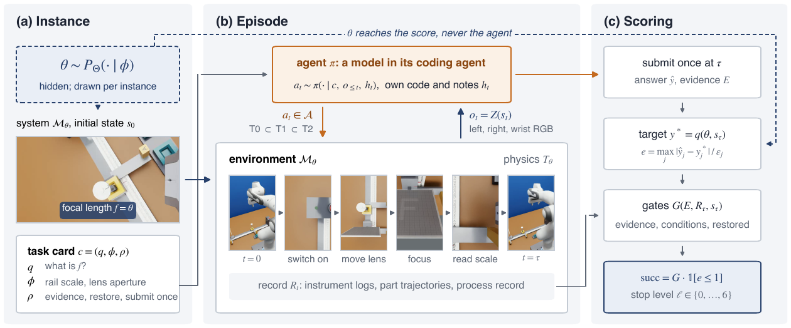
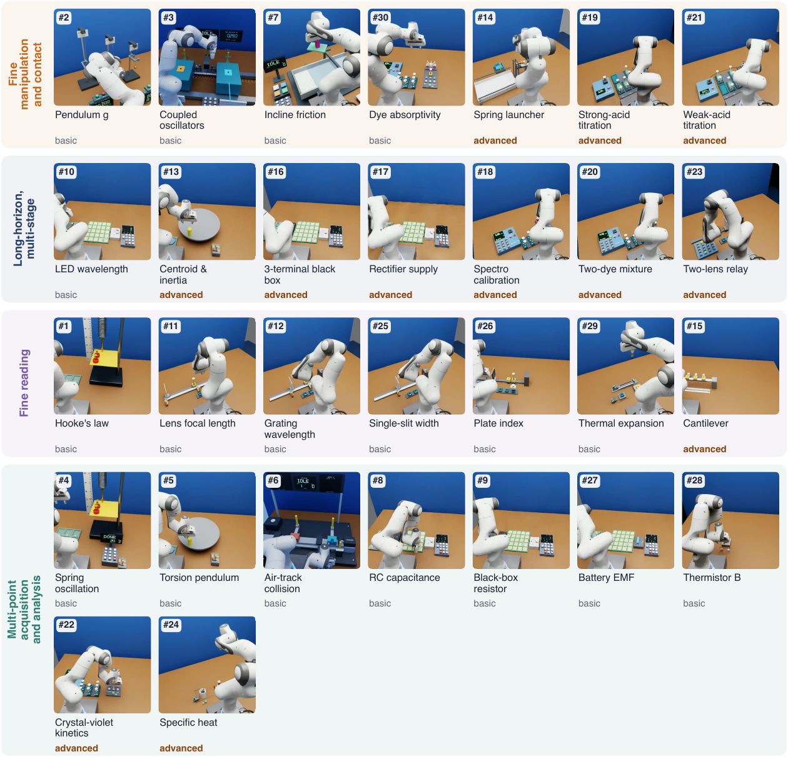
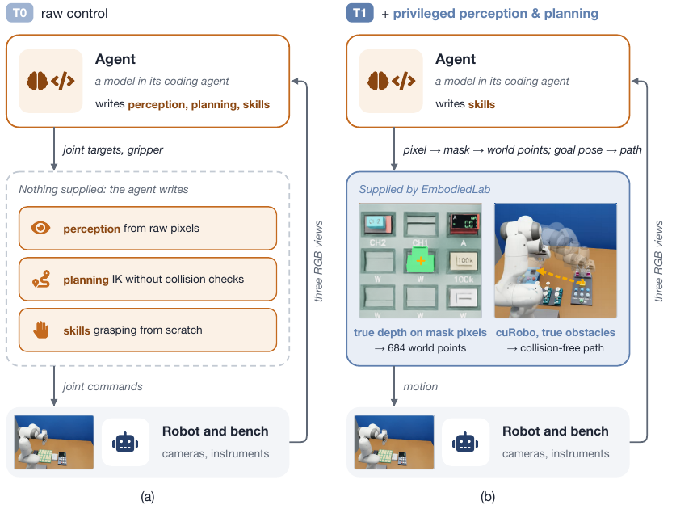
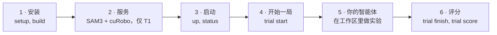
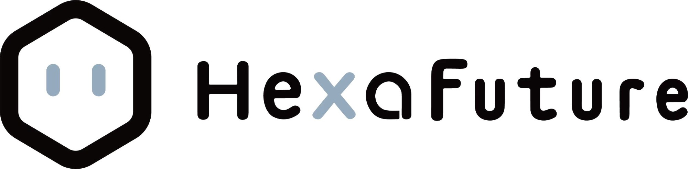

<div align="center">

# EmbodiedLab

### 评测为了知道而行动的具身智能体

操作类基准考的是机器人能不能通过动手改变世界，EmbodiedLab 考的是它能不能通过动手去认知。智能体只拿到实验目标和装置，要在基于物理仿真的实验室里自己完成实验，测出事先无法知道的结果。

[](https://hexafuture.ai/benchmarks/embodiedlab/)
[](https://arxiv.org/abs/2610.35385)
[](LICENSE)
[](https://developer.nvidia.com/isaac/sim)

[English](README.md) | **简体中文**

[简介](#简介) •
[实验](#30-个实验) •
[接口级别](#接口级别) •
[排行榜](#排行榜) •
[快速开始](#快速开始) •
[接入智能体](#接入你的智能体) •
[评分](#评分) •
[引用](#引用)

<a href="https://hexafuture.ai/benchmarks/embodiedlab/#video"></a>

</div>

## 简介

我们期望具身智能体能自己决定怎样、何时与周围环境交互，去完成现实世界里的目标。对很多这类目标来说，改变世界的物理状态只是手段，不是目的。智能体改变一个系统的状态，观察反馈，不断探索，直到知道目标需要什么。我们把这叫作**为了知道而行动**（acting to know）。

现有的操作基准停在"为了改变而行动"：目标状态是事先给定的。科学发现类基准考察的是"知道"，但把物理实验换成了文本指令或数值查询。**EmbodiedLab** 用定量科学实验把两者结合起来。



- 🔬 **5 个学科、30 个实验。** 覆盖力学、电路、光学、热学和化学，建立在 14 个实验平台上，其中 18 个基础实验、12 个进阶实验。
- 🎲 **每次都是新实例。** 系统的隐藏参数每个实例都重新抽取，答案无法事先知道，却能被精确评分。
- 🤖 **方法由智能体决定。** 智能体只拿到目标和实验器材，不给方法。它在基于物理的模拟实验室（NVIDIA Isaac Sim）里操作一台 Franka 机械臂，通过三个相机读取仪器。
- ✅ **只按真正做到的事评分。** 一局实验要同时满足以下三点才算成功：
  - 结果在仪器精度决定的容差之内；
  - 结果有本局记录下的读数作为依据；
  - 实验台恢复到任务要求的状态。
- 🧩 **任何能运行 Python 的智能体都能参加。** 编程智能体、ReAct 循环或手写的控制器，用的都是同一套 API。

<div align="center">

<br><sub><b>一局实验。</b>(a) 每个实例抽取隐藏参数 θ，任务卡说明要测出什么。(b) 智能体通过相机和仪器行动、观察。(c) 提交的结果会同时与隐藏目标、记录下的证据以及实验台的最终状态核对。</sub>
</div>

## 30 个实验

<div align="center">

</div>

每个实验属于四个能力维度之一，维度说明了这个实验难在哪里：

- **精细操作与接触：** 精细的抓取、放置和接触。
- **长程多阶段：** 环环相扣的多个阶段，每一步都要成功。
- **精细读数：** 按仪器分辨率读取刻度、显示和位置。
- **多点采集与分析：** 多次读数，再综合分析。

<details>
<summary><b>完整列表，含学科、维度、容差和预算</b>（点击展开）</summary>

<br>

| # | id | 实验 | 学科 | 维度 | 难度 | 容差 | 模拟时间预算 (s) | 墙钟时限 (s) |
|---|---|---|---|---|---|---|---|---|
| 1 | `hooke_k` | 弹簧劲度系数（胡克定律） | 力学 | 精细读数 | 基础 | 2% | 500 | 7200 |
| 2 | `pendulum_g` | 用单摆测重力加速度 | 力学 | 精细操作 | 基础 | 0.3% | 200 | 7800 |
| 3 | `coupled_modes` | 耦合振子：两个简正模频率 | 力学 | 精细操作 | 基础 | 0.2% | 300 | 15000 |
| 4 | `hooke_dynamic_k` | 由振动测弹簧劲度系数 | 力学 | 多点采集 | 基础 | 0.2% | 500 | 10800 |
| 5 | `torsion_inertia` | 扭摆：转动惯量 | 力学 | 多点采集 | 基础 | 1% | 500 | 15600 |
| 6 | `airtrack_collision` | 气垫导轨：由碰撞测未知质量 | 力学 | 多点采集 | 基础 | 0.5% | 300 | 16800 |
| 7 | `incline_friction` | 斜面上的静摩擦与动摩擦 | 力学 | 精细操作 | 基础 | 5%, 0.5% | 600 | 9600 |
| 8 | `rc_capacitance` | RC 电路中的未知电容 | 电路 | 多点采集 | 基础 | 0.5% | 300 | 17400 |
| 9 | `resistor_blackbox` | 黑盒中的未知电阻 | 电路 | 多点采集 | 基础 | 0.3% | 300 | 14400 |
| 10 | `led_planck` | 未知 LED 的波长 | 电路 | 长程多阶段 | 基础 | 2% | 500 | 21000 |
| 11 | `lens_focal` | 会聚透镜的焦距 | 光学 | 精细读数 | 基础 | 1% | 500 | 14400 |
| 12 | `grating_wavelength` | 用衍射光栅测激光波长 | 光学 | 精细读数 | 基础 | 1% | 200 | 14400 |
| 25 | `slit_width` | 由单缝衍射测缝宽 | 光学 | 精细读数 | 基础 | 1% | 350 | 14400 |
| 26 | `plate_index` | 玻璃砖的折射率 | 光学 | 精细读数 | 基础 | 3% | 500 | 28800 |
| 27 | `battery_emf` | 电池的电动势和内阻 | 电路 | 多点采集 | 基础 | 0.5% | 300 | 13800 |
| 28 | `thermistor_beta` | 热敏电阻的 B 常数 | 热学 | 多点采集 | 基础 | 0.3% | 1000 | 15600 |
| 29 | `rod_expansion` | 金属棒的线膨胀系数 | 热学 | 精细读数 | 基础 | 0.5% | 1200 | 17400 |
| 30 | `dye_absorptivity` | 未知染料的吸收峰和摩尔吸光系数 | 化学 | 精细操作 | 基础 | 1 nm, 2% | 750 | 28800 |
| 13 | `torsion_centroid` | 扭摆：质心和质心转动惯量 | 力学 | 长程多阶段 | 进阶 | 0.3 mm, 0.5% | 550 | 25200 |
| 14 | `projectile_landing` | 弹簧发射器：预测落点并接住小球 | 力学 | 精细操作 | 进阶 | 2% | 650 | 7200 |
| 15 | `beam_compliance` | 悬臂梁：梁的刚度与夹持柔度 | 力学 | 精细读数 | 进阶 | 0.5% | 300 | 14400 |
| 16 | `circuit_blackbox3` | 电路黑盒：辨识网络结构和元件参数 | 电路 | 长程多阶段 | 进阶 | 0.5% | 450 | 19800 |
| 17 | `rectifier_supply` | 整流电源：带载能力与滤波选择 | 电路 | 长程多阶段 | 进阶 | 1% | 350 | 16200 |
| 18 | `spectro_basic` | 分光光度法：未知染料的浓度 | 化学 | 长程多阶段 | 进阶 | 2% | 770 | 14400 |
| 19 | `titration_basic` | 酸碱滴定：盐酸浓度 | 化学 | 精细操作 | 进阶 | 0.5% | 600 | 19200 |
| 20 | `spectro_mixture` | 分光光度法：双染料混合物中的两个浓度 | 化学 | 长程多阶段 | 进阶 | 3% | 990 | 18000 |
| 21 | `titration_weak_acid` | 弱酸滴定：浓度和 pKa | 化学 | 精细操作 | 进阶 | 1%, 0.03 | 850 | 22200 |
| 22 | `kinetics_crystal_violet` | 动力学：结晶紫褪色的反应级数和速率常数 | 化学 | 多点采集 | 进阶 | 2% | 800 | 21600 |
| 23 | `optical_relay` | 双透镜中继：给定放大率的正立实像 | 光学 | 长程多阶段 | 进阶 | 3% | 1500 | 28800 |
| 24 | `calorimetry_specific_heat` | 用混合法测金属比热容 | 热学 | 多点采集 | 进阶 | 1% | 1400 | 15600 |

每个实验的完整说明是它的任务卡 `experiments/<id>/task_card.md`。任务卡写明问题、实验器材、验收条件、预算和提交格式，不给方法。

</details>

## 接口级别

同一套实验可以在两个接口级别下运行，区别只在于智能体能拿到多少机器人软件。级别在环境内部强制执行：不属于该级别的工具既不会列出，也无法调用。

<div align="center">

</div>

| 级别 | 智能体拿到的 | 留给智能体自己的 |
|---|---|---|
| **T0** · 原始控制 | 三个已标定的 RGB 视角、含手部位姿的机器人状态、关节和夹爪控制、只做运动学求解的 `solve_ik`（不做碰撞检查）、仪器和 `submit` | 感知、避碰、路径规划以及所有操作技能 |
| **T1** · 加感知与规划 | T0 的全部，加上 SAM3 分割、把选定像素和掩码反投影到三维的深度，以及用 cuRobo 规划的无碰撞手部运动 | 抓取、放置、按压等所有操作技能 |

[论文](https://arxiv.org/abs/2610.35385)还研究了一个用于诊断的级别 T2，它额外提供一个操作技能库。T2 不在本次发布中。

<details>
<summary><b>T1 的 8 个工具</b></summary>

<br>

| 分组 | 工具 |
|---|---|
| SAM3 | `segment_sam3_point_prompt`（在智能体选定的像素处给出掩码候选），`inspect_mask_image`（某个候选的放大图） |
| 深度 | `localize_rgbd_point`（一个像素对应的世界坐标点），`mask_geometry`（掩码可见点的世界坐标范围和中位点） |
| cuRobo | `move_hand`（规划并执行到某个手部位姿的无碰撞路径），`plan_return_to_start`（同上，回到初始位姿） |
| 辅助 | `translate_contact`（让手沿直线慢速移动最多 5 cm，用来接触或退出接触：cuRobo 不会从接触状态开始规划），`get_robot_pose`（由正运动学算出的手部位姿，与机器人状态中的一致） |

</details>

## 排行榜

我们评测了 6 个前沿模型，每个模型都运行在其开发方发布的编程智能体里，使用该编程智能体的中间推理档位：GPT 和 Claude 模型用 medium，这是 Codex 和 Claude Code 的默认档；另外三个模型开启思考、用 high，这是它们所用编程智能体的中间档。其余设置都保持默认。按 T0 成功率排名。

| 排名 | 模型 | 编程智能体 | T0 成功率 (%) | T0 过程分 | T1 成功率 (%) | T1 过程分 |
|:---:|---|---|:---:|:---:|:---:|:---:|
| 🥇 | Claude Opus 5.5 | Claude Code | **43.3** | **64.0** | **53.3** | **73.7** |
| 🥈 | GPT-6 Astra | Codex | 40.0 | 62.8 | 46.7 | 61.0 |
| 🥉 | GPT-6.1 Sol | Codex | 28.3 | 55.7 | 30.0 | 51.7 |
| 4 | DeepSeek-V4.1-Flash | DSH | 10.0 | 36.0 | 13.3 | 36.7 |
| 5 | Kimi K3 | Kimi Code | 10.0 | 35.7 | 20.0 | 39.7 |
| 6 | GLM-5.3-Flash | ZCode | 0.0 | 16.3 | 3.3 | 20.7 |

成功率和过程分（0–100）先在每个实验的各局之间平均，再在 30 个实验之间平均。更多结果和典型失误见[项目网站](https://hexafuture.ai/benchmarks/embodiedlab/)。

**主要发现**

- **为了知道而行动远未解决。** 在原始控制（T0）下，即使最强的智能体成功率也不到一半。
- **智能体能知道多少，受限于它交互得有多可靠。** 无论强弱，大多数失败都出在与装置的交互上：操作装置、观察装置和复原装置合计占失败的 75%–100%，拿到读数之后在推理上失败的最多只占 25%。
- **帮它看清，不等于帮它操作好。** 感知和运动规划（T1）最多让成功率提高 10 个点；在论文用于诊断的 T2 级别中，操作技能对较弱的智能体帮助更大。

## 快速开始



### 环境要求

| 项目 | 要求 |
|---|---|
| 操作系统 | Linux x86_64 |
| GPU | 24 GB 显存的 NVIDIA RTX GPU（在 RTX 4090 上测试）。一个环境占用 3 到 10 GB；SAM3 和 cuRobo 合计在一块 GPU 上约 10 GB。 |
| 软件 | NVIDIA 驱动，Docker 及 [NVIDIA Container Toolkit](https://docs.nvidia.com/datacenter/cloud-native/container-toolkit/)，Python 3.10 或更高版本并带 `venv`（Debian/Ubuntu：`python3-venv`），git，curl |
| 磁盘 | 实验镜像约 35 GB，SAM3 和 cuRobo 约 15 GB |
| 账号 | 从 NGC 获取 Isaac Sim 基础镜像 `nvcr.io/nvidia/isaac-sim:6.0.1`；Hugging Face 上 [facebook/sam3](https://huggingface.co/facebook/sam3) 的访问权限（仅 T1 需要） |
| 仅 T1 需要 | 用于编译 cuRobo 的 CUDA 12.x 工具包（`nvcc`） |

### 第 1 步 · 安装

```bash
git clone https://github.com/HexaFuture/EmbodiedLab.git
cd EmbodiedLab && git checkout v0.1.0
./embodiedlab setup     # 检查前置条件并创建 .venv
./embodiedlab build     # 构建实验镜像 embodiedlab/lab:0.1.0（同时打上 :latest 标签）
```

> [!TIP]
> GPU、数据目录和端口在 `embodiedlab.conf.local` 里设置（见[进阶 › 配置](#进阶)）。默认使用 GPU 0 和 `./data`。

### 第 2 步 · 安装感知和规划服务（仅 T1）

```bash
./embodiedlab install-services   # SAM3 + cuRobo
```

只在 T0 下评测时，可以跳过这一步，并设置 `EMBODIEDLAB_SERVICES=off`。

### 第 3 步 · 启动服务栈

```bash
./embodiedlab up         # 启动 SAM3、cuRobo、Controller，并为每块 GPU 启动一个 Worker
./embodiedlab status
```

### 第 4 步 · 开始一局实验

```bash
./embodiedlab trial catalog                                                    # 30 个实验（--json 输出 JSON）
./embodiedlab trial start --exp hooke_k --seed 0 --exposure T1 --agent my-agent
```

`trial start` 会启动一个环境，为智能体准备工作区，并打印**智能体提示词**。`--seed N` 会确定性地生成第 N 个实例的隐藏值和台面布局，所以同一种子上的结果可以在不同智能体之间比较。`--agent` 给这局实验打上标签，同一智能体的所有局会放在一起评分。

### 第 5 步 · 让你的智能体做实验

把打印出来的提示词交给你的智能体，并把这局实验的 `workspace/` 设为它的工作目录（见[接入你的智能体](#接入你的智能体)）。智能体提交后，或达到墙钟时限时（`--wall-s`，默认是该实验自己的时限），这局实验结束。

```bash
./embodiedlab trial status <trial_id>    # 目前的工具调用次数，是否已提交
```

### 第 6 步 · 评分

```bash
./embodiedlab trial finish <trial_id>    # 立即结束这局：停止环境并评分
./embodiedlab trial score                # 所有已结束实验的成功率、过程分和误差
./embodiedlab down                       # 停止所有环境和服务栈
```

> [!NOTE]
> **检查安装是否正常。** 完整跑通一局。`trial finish` 会写出 `result.json`，其中的状态是：
> - `submitted`；
> - `not_submitted`；
> - `timeout`（墙钟时间用完）；
> - `budget_exhausted`（模拟时间用完）；
> - `agent_terminated`（智能体触发了物理保护）；
> - `not_scored`（基础设施故障，需要重跑）。
>
> 提交后还会写出 `evaluation.json`。

## 接入你的智能体

智能体能看到和使用的一切都在这局实验的工作区 `data/trials/<trial_id>/workspace/` 里：

```text
workspace/
  task_card.md      问题、实验器材、验收条件、预算、提交格式
  README.md         Python API，以及本级别的工具表
  task_spec.json    机器可读的任务描述，含提交格式
  tools.json        每个工具的名称、签名和说明
  py                绑定到本工作区的 Python
  embodiedlab_api/  客户端（只依赖标准库）
  calls.jsonl       智能体的每一次调用，自动追加
  images/           工具返回的每一张图片
```

智能体只能通过 API 行动，在工作区里用 `./py script.py` 运行自己的代码：

```python
from embodiedlab_api import connect

env = connect()                      # 读取工作区里的 env.json
env.task()                           # 公开的任务说明
env.tools()                          # 本级别可用的工具
obs = env.observe()                  # 三个已标定的 RGB 视角，以 PNG 保存在 images/ 下
env.call("wait", seconds=5)          # 推进模拟时间（计入预算）
env.call("<tool>", **arguments)
env.submit(**fields)                 # 只能提交一次；第一次提交即结束本局
```

智能体可以在工作区里写笔记和自己的辅助代码，但不得读取工作区以外的任何内容。

> [!IMPORTANT]
> **别让智能体接触到隐藏值。** 服务栈会把每局的隐藏参数写到 `data/instances/`。可以任选一种做法：
> - 用另一个用户运行智能体，该用户能读写自己的工作区，但不能读 `data/`；
> - 或者把智能体放到另一台机器上：`./embodiedlab trial pack <trial_id>` 会把工作区打包，供通过 SSH 隧道连接 Controller 的机器使用。

工作区旁边，这局实验的目录里还有评测输出：

- `captures/`：视频、封存的证据和过程记录；
- `evaluation.json`：评测器的报告；
- `process_score.json`：六个过程等级；
- `result.json`：一行汇总。

## 评分

每局结束的实验都有三个分数。它们都是根据环境记录离线算出的，从不采用智能体自己的说法。

**成功。** 每个实验在任务卡里写明验收条件（gate）。所有条件都满足时 G = 1，包括任务卡要求的实验台复原。

每个计分量都有一个容差，由仪器在正确使用时能达到的精度决定：
- 大多数是相对容差，在 0.2% 到 5% 之间；
- 少数是绝对容差，例如 pKa 在 0.03 以内、质心在 0.3 mm 以内、吸收峰在 1 nm 以内。

本局误差 `e` 是各量误差与其容差之比的最大值。G = 1 且 `e ≤ 1` 时，这局实验成功。

**过程分。** 衡量一局走到了哪一步，提交与否都算。它沿着"为了知道而行动"的流程分为六个连续的里程碑：

| 等级 | 里程碑 | 权重 |
|:---:|---|:---:|
| L1 | **上手：** 机器人第一次作用到本实验的器材上 | 10 |
| L2 | **搭好：** 器材处在一个合理方法可以测量的状态 | 10 |
| L3 | 在这种状态下得到**第一个有效读数** | 10 |
| L4 | **数据够了：** 有效读数在原理上足以确定每个计分量 | 10 |
| L5 | **准确：** 除复原外的每个验收条件都通过，且 `e ≤ 1` | 30 |
| L6 | **复原：** 复原条件也全部通过，这局即为成功 | 30 |

过程分是所达到的最高连续等级的累计权重，满分 100。

**误差。** 在有效提交上统计 `e`。

<details>
<summary><b>输出文件，以及如何给一批实验评分</b></summary>

<br>

`trial finish`（或者本局结束时的监视进程）会把分数写进 `result.json`。

`evaluation.json` 列出每个验收条件及其判定。在 `quantities` 下列出每个计分量的：
- 提交值和真值；
- 绝对误差和相对误差；
- 容差，以及误差与容差之比。

`process_score.json` 列出每个等级达到时的模拟时间和原因。L1 到 L4 根据环境停止时导出的过程记录判定，L5 和 L6 根据对封存提交的评测判定（`benchmark/evaluation/process.py`，规则在 `benchmark/evaluation/process_rules/`）。

```bash
./embodiedlab trial score                       # data/trials 下所有已结束的实验
./embodiedlab trial score --root DIR --json     # 另一个实验目录，输出 JSON
```

`trial score` 按智能体标签和级别分组，对每个实验、每个学科以及总体，报告成功率、平均过程分和有效提交的 `e` 中位数。每个实验先对各次运行取平均，总体再对实验取平均，因此每个实验的分量相同；各学科的数字只作分项参考。以 `not_scored` 结束的实验不计入，并单独列出以便重跑。

`result.json` 里还有 `bench_restore`，它只做描述，不计分。对实验台上每件可移动的物品，它给出：
- 相对第一次工具调用前位置的位移；
- 倾斜角度；
- 是否回到原位。

</details>

## 进阶

<details>
<summary><b>实时观看一局实验（Viser）</b></summary>

<br>

环境可以在浏览器里提供整个场景的实时只读 3D 视图（[Viser](https://viser.studio)），供运行基准的人观看。它默认关闭，按局开启：

```bash
./embodiedlab trial start --exp hooke_k --seed 0 --exposure T0 --viewer
./embodiedlab trial viewer <trial_id>     # 它的地址，以及从另一台机器打开它的 SSH 隧道
```

视图监听基准主机的 `127.0.0.1`，与环境同生命周期，不参与控制和评分。它在每个仿真步之后同步场景，所以在智能体第一次推进仿真之前，只显示坐标轴。

- **它显示的比智能体能看到的多，而且没有密码。**
  - 它能从任意角度显示场景里的每个物体。
  - 任何能访问主机 `127.0.0.1` 的进程都能打开它，换一个用户账号也挡不住。
  - 只有在智能体访问不到这个地址时才开启：智能体在另一台机器上（`trial pack`），或在不能访问主机网络的容器里。
  - 否则只在不计分的运行中使用。
- **不要公开它。** 通过 SSH 隧道打开，不要把它的端口转发到公网地址。
- **它会占用主机资源。** 一台主机上环境很多时，它会增加 CPU 负载，可能拖慢实验，使其更接近墙钟时限。

</details>

<details>
<summary><b>配置</b></summary>

<br>

`embodiedlab.conf` 说明了每一项设置。把你自己的值写进 `embodiedlab.conf.local`：格式相同，在 `embodiedlab.conf` 之后读取，不受 git 跟踪。环境变量优先于这两个文件。

| 设置 | 默认值 | |
|---|---|---|
| `EMBODIEDLAB_GPUS` | `0` | 运行环境的 GPU，逗号分隔 |
| `EMBODIEDLAB_SLOTS_PER_GPU` | `1` | 每块 GPU 同时运行的环境数 |
| `EMBODIEDLAB_DATA` | `./data` | 实例、实验记录、日志、缓存，以及 SAM3/cuRobo 的安装目录 |
| `EMBODIEDLAB_SERVICES` | `on` | `off` 表示不启动 SAM3 和 cuRobo（仅 T0） |
| `EMBODIEDLAB_SERVICE_GPU` | `0` | SAM3 和 cuRobo 使用的 GPU |
| `SAM3_CHECKPOINT` | | 用本地的 `sam3.pt` 代替从 Hugging Face 下载 |
| `EMBODIEDLAB_CONTROLLER_PORT` | `18731` | Controller 只监听 127.0.0.1 |

如果 PyPI、PyTorch wheel 源或 GitHub 访问较慢，可以把 `PIP_INDEX_URL`、`EMBODIEDLAB_TORCH_INDEX`、`EMBODIEDLAB_SAM3_REPO` 和 `EMBODIEDLAB_CUROBO_REPO` 指向镜像。`PIP_INDEX_URL` 也会传给镜像构建。

日志在 `data/logs/`（`./embodiedlab logs controller`）。Controller 没有身份验证：请让它只监听 127.0.0.1，其他机器只通过 SSH 隧道访问。

</details>

<details>
<summary><b>故障排查</b></summary>

<br>

- **一局实验启动不了，一直在等 Worker。** 可能有之前的环境还占着它：主机负载高时，Docker 有时会漏掉容器退出事件，导致停止失败（"did not receive an exit event"）。
  - `trial finish` 会持续尝试停止三分钟，然后打印处理办法。
  - `./embodiedlab status` 列出正在运行的环境。
  - 确认容器已退出（`docker ps`）后，`./embodiedlab trial finish <trial_id> --force` 会停止环境、释放 Worker，并重新评分。

</details>

<details>
<summary><b>仓库结构</b></summary>

<br>

```text
embodiedlab          命令行（setup、build、install-services、up、down、status、trial、logs）
embodiedlab.conf     设置
experiments/         30 个实验：experiment.yaml（规格）、task_card.md、schemas/（提交格式）
benchmark/           实验台和物理（core/）、评测器（evaluation/）、实例生成（instances/）、
                     实验注册（registry/）、器材套件（kits/）
sdk/                 运行时：Controller、Worker、环境守护进程，以及智能体 API embodiedlab_api
assets/              实验镜像使用的场景和机器人资产
docker/lab/          实验镜像（Isaac Sim 6.0.1 + 实验台）
services/            T1 使用的 SAM3 和 cuRobo 服务
scripts/trial.py     ./embodiedlab trial 背后的实验运行器
docs/assets/         本 README 中的图片
```

</details>

## 引用

如果你使用了 EmbodiedLab，请引用我们的论文：

```bibtex
@article{gao2026embodiedlab,
  title   = {{EmbodiedLab}: Benchmarking Embodied Agents That Act to Know},
  author  = {Gao, Hongcheng and Zheng, Zelin and Zhou, Alex and Zhu, Jay and Ge, Shijia and Wang, Yazhe and Li, Xiping and Zeng, Jianshu and Wu, Di and Shangguan, Xuan and Wan, Yexing and He, Lingyu and Wang, Yongli and Yu, Xiaohan and Jia, Zhiqi and Liu, Yue and Hooi, Bryan and Dong, Yinpeng and Zhang, Wentao and Wu, Sihang and He, Xiao},
  journal = {arXiv preprint arXiv:2610.35385},
  year    = {2026}
}
```

## 许可证

EmbodiedLab 以 Apache License 2.0 发布（见 [`LICENSE`](LICENSE)）。

它依赖的第三方软件各有自己的许可证，安装时即视为你接受这些许可证：
- NVIDIA Isaac Sim（基础镜像）；
- Meta 的 SAM3（SAM License；模型权重需在 Hugging Face 上申请访问）；
- NVIDIA cuRobo（NVIDIA Source Code License）。

见 [`THIRD_PARTY_NOTICES.md`](THIRD_PARTY_NOTICES.md)。

<div align="center">
<br>
<a href="https://hexafuture.ai"></a>
</div>
